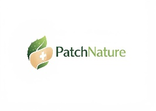
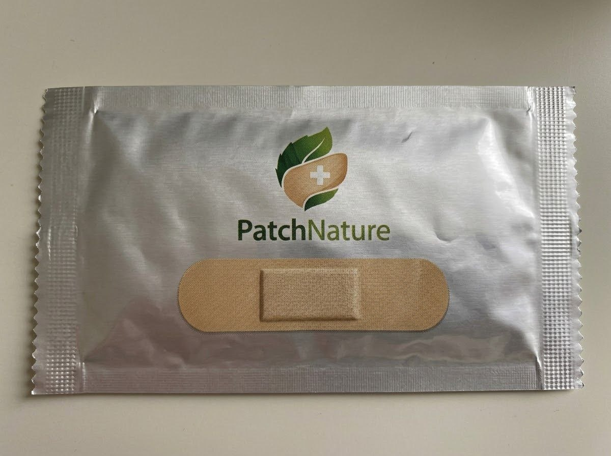
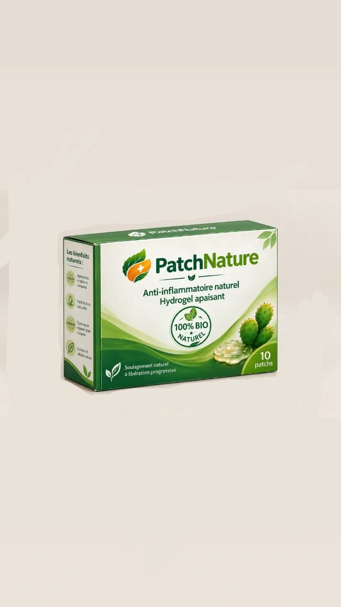

**شعار المؤسسة:**

**الاسم التجاري للمؤسسة : PatchNature**

📧 contact.patchnature@gmail.com  
📞 0775691557  
📘 Facebook : PatchNature  
📷 Instagram : patch_nature  

  
  

# Accueil
## PatchNature

Patch naturel anti-inflammatoire à base d’hydrogel de cladodes de figuier de Barbarie  
Une solution innovante pour les soins de la peau, associant un extrait végétal à la technologie hydrogel.  
Innovation développée en Algérie 🇩🇿  

**Bouton :** Découvrir le produit  

## Notre produit

PatchNature est un patch hydrogel à base de cladodes de figuier de Barbarie (Opuntia ficus-indica), développé pour une application pratique et localisée sur la peau.  

## Les atouts de PatchNature

### Origine végétale
Les cladodes de figuier de Barbarie sont intégrés à la formulation du patch.  

### Technologie hydrogel
Une formulation conçue pour un contact adapté avec la peau.  

### Format pratique
Un patch individuel, simple à appliquer et à retirer.  

### Développement scientifique
Un produit issu d’un projet de recherche universitaire.  

## Mode d’utilisation

### 01 — Nettoyer
Nettoyer et sécher la zone concernée.  

### 02 — Appliquer
Placer le patch directement sur la peau.  

### 03 — Laisser agir
Respecter la durée indiquée sur l’emballage.  

### 04 — Retirer
Retirer délicatement le patch après utilisation.  

## Notre vision

Développer de nouvelles solutions pour les soins de la peau en valorisant les ressources végétales disponibles localement.  

## Une question sur PatchNature ?

Pour en savoir plus sur notre produit et suivre l’évolution du projet, contactez-nous.  

Email : contact.patchnature@gmail.com  
Téléphone : 0775 69 15 57  
Instagram : patch_nature  
Facebook : PatchNature  
